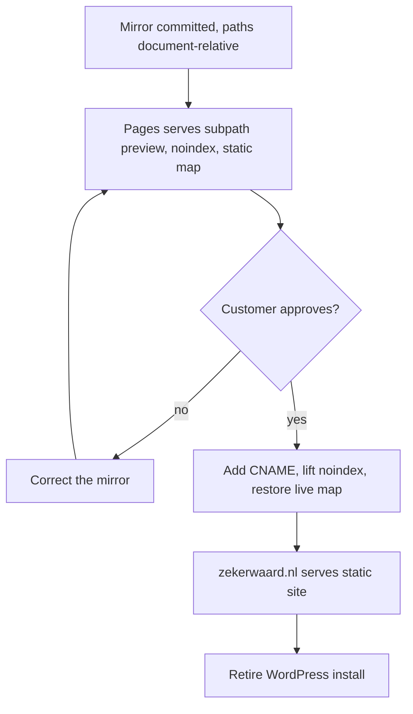
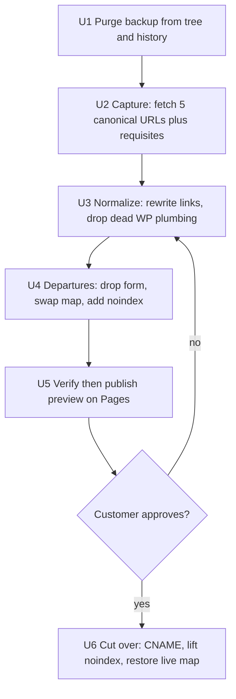

# WordPress Static Mirror - Plan

## Goal Capsule

- **Objective:** Visitors reach the whole of zekerwaard.nl — all five pages, with the scroll animations and homepage slider intact — from static hosting, with no WordPress, PHP or database behind it.
- **Means:** Mirror the rendered live site and commit the result (Product Contract Key Decision "Mirror the rendered site rather than rebuild it").
- **Product authority:** The live site at `https://www.zekerwaard.nl/` is the reference for correctness. Where the mirror and the live site differ, the live site wins, except four deliberate departures: the contact form is removed (R7), the search affordance is removed (R9), the preview carries noindex tags (R10), and the preview shows a static map (R11).
- **Execution profile:** Smoke and runtime verification. A mirror carries no unit-testable logic, so proof comes from loading the served pages and inspecting requests, not from a test suite.
- **Stop conditions:** Stop and ask before force-pushing the rewritten history in U1, and before adding `CNAME` in U6. Stop if the live site becomes unreachable mid-capture, since it is the only capture source.
- **Tail ownership:** This plan ends at a cut-over site. Commit, push and any PR are the caller's to run; the plan does not own them.
- **Open blockers:** None.

## Product Contract

### Summary

Publish a static copy of zekerwaard.nl's five pages on GitHub Pages, preserving the Avada scroll animations and the Revolution Slider exactly. It goes live first at the project-pages subpath for customer sign-off, then moves to zekerwaard.nl by adding a `CNAME` file. The contact form is replaced by plain contact details.

### Problem Frame

The site is a five-page brochure for an insurance and mortgage broker, but it carries a full WordPress install in a `/cms` subdirectory with Avada, Fusion Builder, Fusion Core, Slider Revolution, Contact Form 7 and Yoast. That is a large maintenance and security surface for content that almost never changes.

Two things make the move awkward rather than trivial. The pages are built by a shortcode page builder, so the design exists only in rendered output — and the animations the owner cares about are an Avada feature, not hand-written CSS. Separately, DNS for zekerwaard.nl is not reachable right now, and the customer has to approve the result before anyone touches it, so the static site has to be viewable at a temporary URL before it can claim the real one.

### Key Decisions

- **Mirror the rendered site rather than rebuild it.** Exact fidelity on the Revolution Slider and the Avada animations is worth more here than page weight or editability. (session-settled: user-directed — chosen over a clean static rebuild: the slider's multi-layer timeline will not reproduce faithfully by hand, and the site rarely changes.) Governs R1, R2, R3.
- **Remove the contact form rather than rehost it.** Nothing to sign up for, monitor or secure, and the page already shows full contact details. (session-settled: user-directed — chosen over a hosted form endpoint such as Web3Forms or Formspree: accepts losing web-originated leads in exchange for zero moving parts.) Governs R7.
- **Rewrite references document-relative, not root-relative.** One rewrite serves both the subpath preview and the eventual domain root, so the cutover touches no paths. (session-settled: user-approved — proposed once the subpath-first sequence made a root-relative rewrite a two-pass job.) Governs R4, R12.
- **Preview at the project-pages subpath before cutover.** DNS is unavailable now and the customer gates the move. (session-settled: user-directed — chosen over waiting for DNS access: the customer can be shown a working site immediately.) Governs R10, R12.
- **Substitute a static map image for the preview only.** The live key is referrer-restricted to zekerwaard.nl and would render a grey box on the preview host. (session-settled: user-directed — chosen over whitelisting the preview host in Google Cloud or dropping the map: needs no access to the Google account and keeps the preview looking like the finished page.) Governs R11, R12.
- **Leave the placeholder menu items dead.** Faithful duplication of current behavior for now. (session-settled: user-directed — chosen over fixing or hiding them: they are already dead on the live site and are not this work's problem.) Governs R8.

### Requirements

**Visual and behavioral fidelity**

- R1. All five pages — `home`, `verzekeringen`, `hypotheken`, `over`, `contact` — render indistinguishably from the live site at desktop and mobile widths.
- R2. Scroll-triggered animations fire with the same type, duration and offset as the live site, driven by the same `data-animationType` / `data-animationDuration` / `data-animationOffset` attributes the mirror inherits.
- R3. The homepage Revolution Slider plays its full layer sequence, including autoplay and navigation.

**Paths and hosting**

- R4. Every asset, stylesheet, script and navigation reference resolves document-relative, so the same committed files render correctly whether served from a subpath or a domain root.
- R5. Navigation links resolve to files that exist in the repo, with no reliance on a redirect layer.
- R6. No request issued during page render targets a WordPress endpoint, a PHP script, or the origin's `/cms` tree on the live host.

**Deliberate departures from the live site**

- R7. The contact form is removed, leaving the contact block already on that page — office phone `072-202 92 87`, mobile `06-53 57 29 38`, `info@zekerwaard.nl`, Middenweg 287, 1701 GD Heerhugowaard, KvK 60409215, AFM 12045802 — as the page's only call to action.
- R8. The six placeholder menu items remain present and non-navigating, exactly as they behave on the live site.
- R9. The WordPress search affordance is removed rather than left to fail silently.

**Preview and cutover**

- R10. The preview deployment is excluded from search indexing, so it cannot compete with or displace the live site in search results.
- R11. During the preview, the contact page shows a static image of the current map in place of the live Google Maps embed.
- R12. Cutover to zekerwaard.nl consists of adding a `CNAME` file, lifting the indexing exclusion, and restoring the live map embed — with no changes to asset paths or navigation.

### Key Flows

- F1. Preview, approval, cutover
  - **Trigger:** The mirror is committed and GitHub Pages is enabled on the repo.
  - **Steps:** The site publishes at the project-pages subpath, excluded from indexing and showing the static map. The customer reviews it there. On approval, DNS access is obtained, a `CNAME` is added, the indexing exclusion is lifted and the live map embed is restored. On rejection, corrections land in the mirror and the preview updates in place.
  - **Outcome:** zekerwaard.nl serves the static site, and the WordPress install can be retired.
  - **Covered by:** R10, R11, R12



### Acceptance Examples

- AE1. **Covers R5.** Given a visitor on any of the five pages, when they use the main menu to reach another page, then the target page loads from the repo without a 404 and without passing through a redirect.
- AE2. **Covers R2.** Given a visitor loading a page with animated columns, when those columns scroll into view, then each animates with the direction and duration it uses on the live site, and none is left permanently invisible.
- AE3. **Covers R4, R12.** Given the committed files served from a domain root instead of a subpath, when any page loads, then every stylesheet, script and image resolves, with no file content changed.
- AE4. **Covers R7.** Given a visitor on the contact page, when the page loads, then no form fields are present and the existing phone, email and address block is readable.
- AE5. **Covers R10.** Given the preview URL, when a crawler fetches any page, then indexing is refused.
- AE6. **Covers R11.** Given a visitor on the preview's contact page, when the page loads, then a map image of the office location is visible rather than an empty grey panel.
- AE7. **Covers R6.** Given any of the five pages loaded with the network log open, when the page finishes rendering, then no request targets `www.zekerwaard.nl`, a `.php` script, or an `admin-ajax.php` endpoint.

### Success Criteria

- The customer approves the preview without asking for fidelity corrections to the animations or the slider.
- Cutover is a single commit that adds `CNAME`, removes the indexing exclusion and restores the live map embed.

### Scope Boundaries

- Markup, asset and performance cleanup — removing jQuery, trimming the ~110 scripts, or improving Lighthouse scores. The mirror decision accepts the current weight.
- The seven posts in the WordPress database and the `/author/evberkel/` archive. No blog exists in the navigation and `/blog/` and `/nieuws/` both 404.
- WordPress feeds, `wp-json`, `xmlrpc`, and the admin surface.
- Any content-editing workflow. Content changes mean editing committed HTML; no CMS replaces WordPress.
- Choosing or procuring DNS access. The repoint itself happens in U6 once the customer approves, sequenced by F1; what is out of scope is obtaining the access and deciding the hosting domain.
- Fixing or re-targeting the six placeholder menu items, per R8.

### Dependencies and Assumptions

- The live site must stay reachable while the mirror is taken; it is the only source for the rendered pages. The file and database backups in `wordpress/` are a fallback reference, not the capture source.
- The Google Maps browser key on the contact page is referrer-restricted to zekerwaard.nl, and the key lives in Google Cloud outside this repo. R11 avoids needing that access for the preview; the live embed works again at cutover because the domain matches the existing restriction.
- Avada, Fusion Builder, Fusion Core and Slider Revolution are commercially licensed. Mirroring commits their CSS and JS to a repo that must be public for GitHub Pages on a free plan. This was weighed and accepted when the mirror approach was chosen.
- Web fonts load from `fonts.gstatic.com` and remain third-party requests, per KTD4.
- The work targets the inner repository at `zekerwaard/zekerwaard`, which holds the `kvo1967/zekerwaard` remote. The enclosing `projects` git repository is incidental.

### Sources and Research

- Live site, all returning 200: `/`, `/verzekeringen/`, `/hypotheken/`, `/over/`, `/contact/`. `/blog/` and `/nieuws/` return 404.
- Menu hrefs point at `/cms/verzekeringen`, `/cms/hypotheken` and `/cms/over`, which 301-redirect to the real paths. GitHub Pages has no redirect layer, which is the origin of R5 and the most likely way a naive mirror ships broken navigation.
- Animations are client-side only. `fusion-animations.js` reads the `data-animation*` attributes off `.fusion-animated` elements via jQuery waypoints and adds the keyframe class. Nothing server-side participates, which is why R2 is satisfiable by a mirror.
- The Revolution Slider configuration is inline in the page HTML, so the slider renders without an AJAX round trip.
- The homepage carries 142 absolute `https://www.zekerwaard.nl` references plus three protocol-relative `//www.zekerwaard.nl` references for `sr7.js`, `tptools.js` and font-awesome. These drive R4.
- The contact page already renders a full contact block outside the form — office phone `072-202 92 87`, mobile `06-53 57 29 38`, `info@zekerwaard.nl`, Middenweg 287, 1701 GD Heerhugowaard, KvK 60409215, AFM 12045802 — so R7 removes the form without needing new content.
- Contact Form 7 posts to PHP and the page references `admin-ajax.php`; the form has fields `contact-name`, `contact-email`, `contact-tel`, `contact-message` plus reCAPTCHA. This is the only genuinely server-dependent feature, and the origin of R7.
- WordPress backup: `wordpress/Zekerwaard/Bestanden/cms/` for files, `wordpress/Zekerwaard/Database/com-linweb1061_srv_combell-ops_net.sql` for the database. The dump records `siteurl` as `https://www.zekerwaard.nl/cms` and `home` as `https://www.zekerwaard.nl/`.

---

## Planning Contract

**Product Contract preservation:** Product Contract unchanged — no R, F or AE changed meaning or numbering. Two items were resolved in place rather than left dangling: the four `Deferred to Planning` questions are now answered by KTD1–KTD8, so that section is gone, and the Google Fonts conditional in Dependencies now cites KTD4 instead of deferring the choice.

### Key Technical Decisions

- KTD1. **Fetch the five canonical page URLs explicitly; do not crawl.** Recursive mirroring follows the `/cms/<slug>` menu links, which 301-redirect, and wget stores each response under the *requested* path — yielding extensionless files that GitHub Pages serves as `application/octet-stream`, so browsers download them instead of rendering. An explicit page list writes correct `<slug>/index.html` paths on the first pass. Governs R1, R5.
- KTD2. **Remap query-string filenames via wget's `--restrict-file-names=windows`.** 128 mirrored assets carry `?ver=` suffixes. A static host strips the query and 404s the file. The remap rewrites `?` to `@` in both filename and reference, which is a legal static path. Governs R1, R4.
- KTD3. **Keep the `/cms/wp-content/` directory layout verbatim.** The generated Avada stylesheet rewrites its `url()` references relative to that layout (`../../themes/Avada/assets/images/...`). Flattening the tree breaks every background image and icon font it references. Governs R4.
- KTD4. **Leave web fonts as remote requests to `fonts.gstatic.com`.** (session-settled: user-directed — chosen over self-hosting the font files: keeps the mirror faithful and adds no build step, accepting a third-party request from a Dutch site.) Governs R1.
- KTD5. **Remove the WordPress backup from the working tree and purge it from git history before Pages is enabled.** (session-settled: user-directed — chosen over deleting it from the tree only, hosting from a private repo, or publishing from a separate repo: the credentials and database dump are already pushed, so only a history rewrite closes the exposure.)
- KTD6. **Produce the preview map as a static screenshot of the live embed.** Needs no Google Cloud access and no API key, and the image is discarded at cut-over. Governs R11.
- KTD7. **Verify the mirror with scripted checks, not visual inspection.** Three failure modes are invisible on a rendered page: query-string filenames, a stylesheet-referenced background image wget does not fetch, and menu links that resolve only through a redirect. Governs R1, R4, R5, R6.
- KTD8. **Rewrite links with a scripted pass over the mirrored files rather than by hand.** wget leaves 193 same-host absolute references across 8 files, including the menu. Hand-editing five pages plus a 1MB stylesheet is error-prone and unrepeatable when the mirror is retaken. Governs R4, R5.

### High-Level Technical Design

The work is a five-stage pipeline. Each stage's output is the next stage's input, and the verification gate sits between capture and publish because that is where the silent failures live.



### Output Structure

Expected repo shape after U5. The per-unit `**Files:**` lists stay authoritative; this tree is the scope declaration.

```text
.
├── .nojekyll                 # stop Jekyll touching _-prefixed Avada paths
├── .gitignore                # keep the relocated backup out
├── index.html                # home
├── verzekeringen/index.html
├── hypotheken/index.html
├── over/index.html
├── contact/index.html        # form removed, static map
├── assets/map-preview.png    # preview-only, removed at cut-over
├── cms/wp-content/...        # Avada/Fusion/revslider CSS, JS, uploads (verbatim layout)
├── robots.txt
└── docs/plans/...            # this plan
```

### Assumptions

- The live site stays reachable and unchanged for the duration of the capture. It is the only capture source; the committed backup is a reference, not a substitute.
- The repo has no collaborators and two commits, so rewriting history and force-pushing is safe without coordination.
- GitHub Pages is served from the repo root on the default branch.

### Risks

- **The capture is a point-in-time freeze.** Any later edit in WordPress would silently diverge from the mirror. The content has been unchanged for years, so the exposure is small; retiring the WordPress install after cut-over, which F1 sequences, closes it.
- **Commercial theme code enters a public repo.** Avada, Fusion Builder, Fusion Core and Slider Revolution ship under a licence that does not contemplate redistribution. This was weighed and accepted when the mirror approach was chosen; it is recorded here so a reviewer sees it rather than discovering it.
- **The committed backup exposed personal data, not only a password.** The dump carried user records and WordPress auth salts alongside the database credentials, so this may be a reportable personal-data breach under Dutch and EU rules rather than only a secret to rotate. History rewriting removes the files from the repo but not from clones or caches that already exist; rotation plus a decision on notification is the actual remedy.
- **wget silently under-fetches CSS-referenced assets.** One such miss is already known. U3 closes it by auditing rather than by trusting the tool.

### Sequencing

U1 must land before U5, since U5 makes the repo public. U2 → U3 → U4 are strictly ordered: normalization assumes a complete capture, and the departures assume normalized links. U6 waits on customer approval and on DNS access.

---

## Implementation Units

### U1. Purge the WordPress backup from the repo and its history

- **Goal:** The repo contains no WordPress backup, and no commit in its history contains one.
- **Requirements:** Prerequisite for R10 and R12; enables publishing at all. Owned by KTD5.
- **Dependencies:** None.
- **Files:** `wordpress/` (delete, 11,986 files), `.gitignore` (create).
- **Approach:**
  1. Move `wordpress/` to a location outside the repo so the backup survives as a local artifact.
  2. Delete it from the working tree and add a `.gitignore` entry so it cannot return.
  3. Purge it from every commit with `git filter-repo`, then force-push the rewritten branch.
  4. Rotate the database password recorded in the backup's `wp-config.php`.
- **Execution note:** Confirm with the user before the force-push. Verify the purge locally before rewriting the remote.
- **Test scenarios:**
  - Searching the full git history for the backup path returns no objects.
  - Searching the full git history for the `DB_PASSWORD` literal returns no matches.
  - Repo size after purge is under 20MB, down from roughly 360MB.
  - A fresh clone contains no `wordpress/` directory at any commit.
- **Verification:** A fresh clone of the pushed branch has no backup directory and no credential string at any point in its history.

### U2. Capture the five pages and their assets from the live site

- **Goal:** A complete local copy of the five pages at correct paths, with every asset they need.
- **Requirements:** R1, R2, R3. Owned by KTD1, KTD2, KTD3.
- **Dependencies:** U1.
- **Files:** `index.html`, `verzekeringen/index.html`, `hypotheken/index.html`, `over/index.html`, `contact/index.html`, `cms/wp-content/**`, `robots.txt`.
- **Approach:**
  1. Fetch each of the five canonical page URLs individually with page requisites, link conversion, no host directories, and `--restrict-file-names=windows` (per KTD1, KTD2).
  2. Do not enable recursion — the menu links are the trap KTD1 describes.
  3. Fetch the stylesheet-referenced background image wget omits, into its original path.
  4. Leave the `cms/wp-content/` layout untouched (per KTD3).
- **Execution note:** Mostly capture and configuration; prove it by serving the directory locally and loading each page, not by unit coverage.
- **Test scenarios:**
  - Covers AE2. Each of the five pages, served locally, animates its columns on scroll with the live site's direction and duration, and leaves none permanently invisible.
  - The homepage slider autoplays through its full layer sequence and responds to its navigation controls.
  - Every page resolves at `<slug>/index.html`; no extensionless page file exists under `cms/`.
  - No mirrored filename contains a `?` character.
  - The Avada generated stylesheet is present at roughly 1MB and its `url()` references resolve to files that exist.
- **Verification:** All five pages render correctly from a local static server with no console 404s.

### U3. Normalize links and strip server-dependent plumbing

- **Goal:** Every reference is document-relative and every navigation target exists as a file.
- **Requirements:** R4, R5, R6. Owned by KTD7, KTD8.
- **Dependencies:** U2.
- **Files:** the five page files, `cms/wp-content/uploads/fusion-styles/*.min.css@ver=3.0.1`, `robots.txt`.
- **Approach:**
  1. Rewrite menu hrefs from `/cms/<slug>` to the depth-correct relative `<slug>/` form.
  2. Rewrite the residual same-host absolute *asset and navigation* references — 193 occurrences across 8 files — to document-relative paths.
  3. Leave canonical, Open Graph and JSON-LD URLs absolute and pointing at `https://www.zekerwaard.nl/`. R6 forbids live-origin *requests*; these are metadata, and relative canonicals break search and social sharing.
  4. Remove the `<link>` elements for feeds, comment feeds, `wp-json` and oembed, which cannot resolve on a static host.
  5. Remove the WordPress search form (R9).
  6. Clean `robots.txt`: drop the `Sitemap:` line, since the static site publishes no sitemap.
  7. Re-audit for any remaining same-host absolute asset or navigation reference and any referenced-but-absent asset.
- **Execution note:** Script the rewrite so retaking the mirror is cheap; a hand-edit pass cannot be repeated reliably.
- **Test scenarios:**
  - Covers AE1. From each of the five pages, every main-menu link reaches its target page without a 404 and without a redirect.
  - Covers AE7. Loading each page issues no request to `www.zekerwaard.nl`, any `.php` script, or `admin-ajax.php`.
  - Covers AE3. Serving the same files from a domain root instead of a subpath renders every page with all assets resolving, with no file content changed.
  - A search of all mirrored files for `zekerwaard.nl` returns only canonical, Open Graph and JSON-LD metadata URLs — no asset or navigation reference.
  - Every `url()` target in the generated stylesheet exists on disk.
  - No search input is present on any page.
- **Verification:** The scripted audit reports zero same-host absolute references and zero missing assets.

### U4. Apply the deliberate departures from the live site

- **Goal:** The contact form is gone, the preview map is static, and the preview cannot be indexed.
- **Requirements:** R7, R8, R10, R11. Owned by KTD6.
- **Dependencies:** U3.
- **Files:** `contact/index.html`, the five page files (noindex), `assets/map-preview.png` (create).
- **Approach:**
  1. Remove the Contact Form 7 markup and its reCAPTCHA script from the contact page, leaving the existing contact block untouched (per R7).
  2. Capture a screenshot of the live interactive map and swap it in for the embed (per KTD6).
  3. Add a robots `noindex` meta tag to all five pages (per R10).
  4. Leave the six placeholder menu items exactly as they are (per R8) — this unit changes nothing about them and must not "fix" them.
- **Execution note:** These are edits to captured files. If U2 is ever re-run, replay this unit — a fresh capture restores the form, the live map embed and the missing noindex tags.
- **Test scenarios:**
  - Covers AE4. The contact page presents no form fields, and the office phone, mobile, email and postal address remain readable.
  - Covers AE6. The contact page shows a map image of the office location rather than an empty grey panel.
  - Covers AE5. Each page carries a robots `noindex` directive.
  - The six placeholder menu items are still present and still non-navigating.
  - No reCAPTCHA request is issued on any page.
- **Verification:** The contact page renders with details and a map image, no form, and all five pages report noindex.

### U5. Publish the preview on GitHub Pages

- **Goal:** The mirror is live at the project-pages subpath for customer review.
- **Requirements:** R10; proves R1 through R9 on real hosting.
- **Dependencies:** U1, U4.
- **Files:** `.nojekyll` (create).
- **Approach:**
  1. Add `.nojekyll` so Jekyll does not drop `_`-prefixed Avada asset paths.
  2. Commit the mirror and enable Pages on the default branch, serving from the repo root.
  3. Re-run the U3 audit against the *served* URLs rather than local files, since host behaviour differs from a local server.
- **Execution note:** The first served load is the real proof. Content-type and case-sensitivity problems appear only on the host.
- **Test scenarios:**
  - Each of the five pages returns 200 at the subpath URL.
  - No asset request on any page returns 404 or a non-matching content type.
  - Page HTML is served as `text/html`, not `application/octet-stream`.
  - Animations and the slider behave as they do locally.
  - A crawler fetch of any page is refused indexing.
- **Verification:** All five pages load correctly at the public preview URL with a clean network log.

### U6. Cut over to zekerwaard.nl

- **Goal:** The custom domain serves the static site and the preview-only compromises are reverted.
- **Requirements:** R12.
- **Dependencies:** U5 plus customer approval and DNS access.
- **Files:** `CNAME` (create), `contact/index.html`, the five page files, `assets/map-preview.png` (delete).
- **Approach:**
  1. Add `CNAME` with the apex or `www` host and point DNS at GitHub Pages.
  2. Remove the `noindex` tags.
  3. Restore the live Google Maps embed in place of the screenshot and delete the image.
  4. Change no asset path or navigation reference. Document-relative references already work at a domain root, which is what the Product Contract Key Decision "Rewrite references document-relative" bought.
- **Execution note:** Confirm with the user before adding `CNAME`; this is the step that moves live traffic. Rollback is a DNS revert to the existing WordPress host, so leave that install running until the static site is confirmed on the domain, and retire it only afterwards.
- **Test scenarios:**
  - All five pages return 200 at the zekerwaard.nl URLs with every asset resolving.
  - No page carries a noindex directive.
  - The contact page shows the live interactive map, not the screenshot.
  - A diff against the preview commit touches only `CNAME`, the noindex tags, and the map block.
- **Verification:** zekerwaard.nl serves all five pages correctly and is indexable.

---

## Verification Contract

The repo has no test runner, and a mirror has no unit-testable logic. Proof is scripted auditing plus served-site smoke checks.

| Gate | What it proves | Applies to |
|---|---|---|
| No filename contains `?` | Assets will not 404 on a static host (KTD2) | U2, U5 |
| No same-host absolute asset or navigation reference remains in any mirrored file, metadata URLs excluded | Pages do not fall back to the live origin (R6) without breaking canonicals | U3, U5 |
| Every `url()` target in the generated stylesheet exists on disk | No silently missing background or icon asset (KTD7) | U3 |
| Every main-menu href resolves to an existing file | Navigation works without a redirect layer (R5, AE1) | U3, U5 |
| No extensionless page file exists under `cms/` | Pages render instead of downloading (KTD1) | U2, U5 |
| All five pages return 200 with a clean network log | The site works on the real host | U5, U6 |
| Full git history contains no backup path and no credential literal | The exposure is closed (KTD5) | U1 |
| Served HTML has content type `text/html` | Host serves pages as pages | U5 |

---

## Definition of Done

Global:

- All five pages load correctly at the live zekerwaard.nl URLs with no console errors and no 404s.
- Scroll animations and the homepage slider behave as they do on the original site.
- Every gate in the Verification Contract passes against the served site, not only locally.
- No WordPress backup, credential, or database dump exists anywhere in the repo or its history, and the exposed password is rotated.
- The contact page shows contact details and the live map, and carries no form.
- Cut-over touched only `CNAME`, the noindex tags, and the map block.
- Scratch output from the capture and rewrite passes — probe directories, intermediate copies, abandoned scripts — is removed from the repo rather than left in the diff.

Per unit: each of U1 through U6 meets its own **Verification** line above.

---
