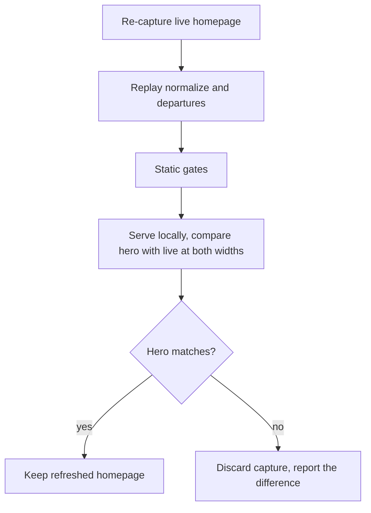

# Homepage Mirror Refresh - Plan

## Goal Capsule

- **Objective:** A visitor comparing the mirror's homepage with zekerwaard.nl finds no difference the mirror did not deliberately choose — same content, same hero behavior.
- **Means:** Re-capture the live homepage and replay the committed normalize and departures passes (KTD1).
- **Product authority:** The live site at `https://www.zekerwaard.nl/` is the reference for correctness, with the deliberate departures of `docs/plans/2026-11-04-1652-feat-wordpress-static-mirror-plan.md` unchanged.
- **Execution profile:** Capture plus browser comparison. The drift is a slider configuration record, so proof comes from watching the hero play beside the live one, not from a test suite.
- **Stop conditions:** Stop if the hero fails parity — report the difference and leave the current homepage in place. Stop if the live homepage shows drift beyond the slider record, rather than installing changes nobody has reviewed. Stop if the live site becomes unreachable mid-capture, since it is the only capture source.
- **Tail ownership:** This plan ends at a refreshed, accepted homepage. Commit and push are the caller's to run.
- **Open blockers:** None.

---

## Product Contract

### Summary

Refresh the mirror's homepage against the restored live page, and accept it only once its hero slider behaves identically to live at desktop and mobile widths. The other four pages and the preview-to-cutover sequence are untouched.

### Problem Frame

The homepage on zekerwaard.nl went missing by mistake and has been restored. The mirror is a capture taken on 2026-11-04, before the page disappeared, so it holds the pre-restore state.

What the restore changed is invisible on the page. Visible text is identical on all five pages, every image and upload the restored homepage references already exists in the repo, and the slider runtime files are byte-identical to the mirrored copies. The one thing that moved is the homepage's inline Slider Revolution record: re-saving the page migrated it from the plugin's v6 shape to the native SR7 shape, which relocates the slide background into a layer and repopulates the per-breakpoint height arrays the mirror holds empty.

That lands on the one feature the site's owner cares about most, and it cannot be judged from markup — only from watching the hero play. The mirror plan's own risk entry predicted this exposure in the abstract: "The capture is a point-in-time freeze. Any later edit in WordPress would silently diverge from the mirror." This is the first time it has actually fired, and it will keep firing until cutover retires the WordPress install.

### Key Decisions

- **Re-capture the homepage rather than patch the slider record.** (session-settled: user-directed — chosen over a full five-page re-capture, leaving the mirror untouched, or building capture tooling first: only the homepage drifted, and the live site is the contract's reference.) Governs R1, R2.
- **Accept on side-by-side parity with live, not on static gates alone.** (session-settled: user-directed — chosen over the static gates only, or a local check that the hero merely plays: the migrated configuration has never been seen render.) Governs R5, R6.
- **Shipping nothing is a legitimate outcome.** (session-settled: user-approved — chosen over shipping the refreshed capture with known hero drift: the current homepage is a verified-good capture of the same content.) Governs R7.
- **Record the capture invocation instead of committing a capture script.** The flags are where the known failure modes live, and no capture step exists in `tools/` today. (session-settled: user-approved — chosen over a committed capture script with a drift-detection gate: new tooling was out of scope for this round.) Governs R8.

### Requirements

**Content fidelity**

- R1. The mirror's homepage carries the live homepage's current content, including the migrated Slider Revolution record and the slide identifiers that come with it.
- R2. The four sub-pages — `verzekeringen`, `hypotheken`, `over`, `contact` — are unchanged by this work.
- R3. Every asset the refreshed homepage needs resolves to a file in the repo, including the URLs Slider Revolution builds in JavaScript rather than writing into the markup.

**Preserved departures**

- R4. The refreshed homepage satisfies the requirements the mirror plan already places on it — `docs/plans/2026-11-04-1652-feat-wordpress-static-mirror-plan.md` R2, R4, R5, R6, R9 and R10 — after the refresh, not only before it.

**Acceptance**

- R5. The refreshed hero plays its full layer sequence, with autoplay and navigation, matching the live hero's timing and behavior at desktop and mobile widths.
- R6. Parity is established by comparing the locally served mirror against the live page in a browser at both widths.
- R7. When parity fails, the refresh is not shipped: the current homepage stays and the report names what differed.

**Repeatability**

- R8. The capture invocation used for this refresh is recorded in the repo, so the next refresh replays it rather than reconstructing it from prose.

### Key Flows

- F1. Refresh and accept
  - **Trigger:** The live homepage differs from the mirror's copy of it.
  - **Steps:** Re-capture the live homepage with its requisites; replay the normalize and departures passes; run the static gates; serve the mirror locally and compare its hero against live at desktop and mobile widths; keep the capture on parity, discard it on failure.
  - **Outcome:** Either the mirror's homepage tracks live and the preview updates, or the mirror is unchanged and the mismatch is reported.
  - **Covered by:** R1, R4, R5, R6, R7

### Acceptance Examples

- AE1. **Covers R5, R6.** Given the refreshed mirror served locally beside the live homepage at a desktop and a mobile width, when both heroes play through, then the layer sequence, autoplay and navigation behave the same in both, with no layer left invisible or mistimed.
- AE2. **Covers R7.** Given a parity comparison that fails, when the work concludes, then `index.html` is the pre-refresh file and the report states which aspect of the hero differed.
- AE3. **Covers R2.** Given the refresh is accepted, when its diff is reviewed, then `index.html` is the only mirrored page it touches.
- AE4. **Covers R4.** Given the refreshed homepage, when the static gates run, then they pass — including the noindex directive, the absent search affordance, no surviving Contact Form 7, reCAPTCHA or Fusion Maps handle, and no live-host asset reference.
- AE5. **Covers R5.** Given the refreshed hero left to autoplay through a full cycle, when it returns to its start, then it does not pass through an empty frame — live now emits a second, empty slide that has no row in the pre-deletion database.

### Success Criteria

- The customer reviewing the preview cannot tell the homepage apart from the live one.
- The next live change is answered by replaying recorded steps, not by reconstructing a capture command.

### Scope Boundaries

- Cutover — adding `CNAME`, lifting the noindex directives, restoring the live map embed. Still gated on customer approval and DNS access, per the mirror plan's U6.
- A committed capture script or an automated drift-detection gate.
- The four sub-pages, which show no content drift.
- Re-capturing the shared asset tree wholesale. The slider runtime and the homepage's Avada dynamic stylesheet are byte-identical to live, so the only assets this refresh adds are the six Slider Revolution files named in KTD7.

#### Deferred to Follow-Up Work

- Capture the four Slider Revolution JavaScript modules that exist separately on the live host — `page.js`, `defaults.js`, `migration.js` and `libs/webgl.js`. The runtime can construct URLs for them from its declared `SR7.E.modules` and `SR7.E.libs` lists, but nothing requested them at this refresh and `webgl.js` alone is 645KB. Capture one only when a served load 404s for it.

### Dependencies and Assumptions

- The live homepage stays reachable and in its restored state for the duration of the capture. It is the only capture source.
- The slider runtime is unchanged: live `sr7.js` and the mirrored copy are both 343,623 bytes and both report internal version 6.7.4. Only WordPress's enqueue stamp moved to `?ver=6.8.1`, and `tools/normalize-mirror.py` strips version suffixes.
- The homepage's Avada dynamic stylesheet is still `cms/wp-content/uploads/fusion-styles/302e8020ed09e50e22dd87f58343bb29.min.css`, so a homepage-only re-capture cannot desync the stylesheet the sub-pages share; theirs is `5ee14afa94f015be0307b6b137b5fc54.min.css` and both files are on disk.
- The live homepage no longer enqueues the font-awesome stylesheet bundled with Slider Revolution, which the current mirror still references. After the refresh that reference disappears and the file stays on disk unreferenced.
- The mirror is still in preview state — noindex on all five pages, a static map, no `CNAME` — so a wrong refresh affects a preview, and rollback is reverting one commit.
- The pre-deletion WordPress backup remains available outside this repo as a reference, never inside it: its database dump carries credentials and user records, and that exposure was already closed once by a history rewrite.
- Firefox is the browser available for the parity comparison. No Chrome or Chromium is installed, and Playwright is not present.

### Outstanding Questions

None. Both questions the brainstorm deferred are resolved: the capture invocation is recorded per KTD4, and the parity comparison is driven by hand per KTD5.

### Sources and Research

- Live-versus-mirror diff taken 2026-11-05 across all five pages: visible text is identical apart from the search affordance the mirror removes, and the contact page's search-overlay close control.
- The homepage slider record is the whole of the drift. The mirror carries the v6 shape — `"version":"6.6.21"`, slide background in `params.bg`, a duplicated `<sr7-slide id="SR7_1_1-1">`, and `el:[""]`. Live carries the native shape — `"settings":{"migrated":"sr6"}`, version `6.8.1`, the background as layer `17`, a correct `id="SR7_1_1-2"`, and populated `gh`/`gw` breakpoint arrays.
- The pre-deletion database dump holds the `home` slider in the same un-migrated v6 shape the mirror renders (`sourcetype: gallery`, `layouttype: fullwidth`), with exactly one slide row titled `Slide` over `Erwin_van_Berkel_Zekerwaard-1.jpg`. The mirror's slider config is therefore a faithful rendering of the original record, and the empty second slide now on live has no counterpart in it.
- The backup bundles Slider Revolution 6.2.17, the mirrored runtime reports 6.7.4, and live stamps 6.8.1. The plugin was updated on live after the backup was taken, and the re-save migrated the stored record; the format change is plugin-side, not content.
- The homepage's live-only script enqueues are the Contact Form 7, reCAPTCHA and Fusion Maps handles that `tools/apply-departures.py` already strips by handle across all five pages.
- Of 126 same-host `/cms/` references on the live homepage, the only ones with no file in the repo are navigation paths the pipeline rewrites plus `admin-ajax.php`, `xmlrpc.php` and the WordPress emoji loader, all of which the pipeline strips.
- A validation capture of the live homepage run during planning produced 247 files and 7MB, with `index.html` at its root, 112 `@ver=` references in that page, and 116 `@`-named files on disk.
- No capture step exists in `tools/`; the original capture was an ad-hoc `wget` invocation described only in prose in the mirror plan's U2 and its commit message.
- The refresh's first attempt failed parity with a hero that showed a preloader and nothing else. Cause: the runtime builds its stylesheet URLs as `SR7.E.plugin_url + "public/css/" + …`, so `sr7.lp.css`, `sr7.btns.css` and `sr7.media.css` were never captured and no gate could see their absence. The legacy slider record did not request them; the migrated record does. They load in a chain, so each one added exposed the next 404 — three successive served loads were needed to find all of them, and the request log was what identified each.
- Of the fourteen assets the page's declared lists can construct, a clean load requested four: `sr7.lp.css`, `sr7.btns.css`, `sr7.media.css` and `preloaders/t4.css`. `sr7.filters.css` and `sr7.nav.css` are captured as well because `SR7.E.css` declares them; the JavaScript modules are not, per Deferred to Follow-Up Work.

---

## Planning Contract

**Product Contract preservation:** R3 was clarified during implementation to name runtime-constructed URLs explicitly, after a served load proved the mirror was missing assets no gate could see; its intent — every asset the page needs resolves locally — is unchanged, and no other R, F or AE changed meaning and no ID was renumbered. Two additions: AE5 records the empty-second-slide case the pre-deletion dump surfaced, under the existing R5; and Dependencies plus Sources gained the dump's findings and the browser constraint. The brainstorm's two `Deferred to Planning` questions are answered by KTD4 and KTD5, so that section now states none.

### Key Technical Decisions

- KTD1. **Capture into a throwaway directory and install only `index.html`.** Capturing in place re-downloads 116 `@ver=`-named asset files alongside the already-renamed terminal copies, and the version-suffix pass then reports a rename collision for each. Governs R1, R2.
- KTD2. **Make the version-suffix pass rewrite references even when it renames nothing.** `strip_version_suffixes()` in `tools/normalize-mirror.py` returns early on `if not renames`, so once the on-disk files carry terminal extensions a freshly captured page keeps its `@ver=` references. The validation capture carries 112 of them. Governs R3, R4.
- KTD3. **Widen `HOST` in `tools/mirror_common.py` to make the scheme optional.** The restored page's new `<image_lists>` element carries `data-src="//www.zekerwaard.nl/cms/…"`; the current pattern requires `https?://`, and wget's `--convert-links` does not touch `data-src`. Widening the shared constant covers every rule that uses it in one change. Governs R3, R4.
- KTD4. **Record the refresh sequence in `tools/README.md`.** (session-settled: user-approved — chosen over a committed capture script with a drift-detection gate: new tooling was out of scope, but the invocation's flags carry the known failure modes.) Governs R8.
- KTD5. **Run the parity comparison by hand in Firefox.** (session-settled: user-directed — chosen over scripting it with Playwright through `npx`, or connecting the Chrome extension: no Chrome, Chromium or Playwright is installed, and the repo carries no build tooling to host them.) Governs R5, R6.
- KTD7. **Capture the stylesheets Slider Revolution constructs at runtime, from the page's own declared list.** The runtime concatenates them from `SR7.E.plugin_url`, so they appear in no attribute and `wget` cannot discover them; the page declares the set as `SR7.E.css`, mapped by `name.replace("css", "sr7.") + ".css"`. Omitting them leaves the hero showing a preloader forever, and the stylesheets load in a chain so each one added only exposes the next 404. Governs R3, R5.
- KTD8. **Give the gate script's attribute audit a name boundary and audit `data-src` deliberately.** `(?:src|href)=` matched any attribute ending in those letters, so Slider Revolution's `data-dbsrc="<base64>"` was harvested as a URL and the served gate 404'd on it. Governs R3.
- KTD6. **Diagnose a parity failure against the pre-deletion database dump, read in place outside the repo.** Its slider row is the only independent record of what the hero should be. It also carries database credentials and user records, so it is never copied into this public repo. Governs R7.

### High-Level Technical Design

A freshly captured page carries six classes of same-host reference, and the replay handles each in a different pass. The two that no pass currently handles are what KTD2 and KTD3 fix.

| Reference class, as captured | Example from the validation capture | Handled by |
|---|---|---|
| Asset under `/cms/`, absolute | `https://www.zekerwaard.nl/cms/wp-content/uploads/2018/07/hypotheek.png` inside an inline `style` | Normalizer's asset rule |
| Navigation to a sub-page | `href="https://www.zekerwaard.nl/cms/hypotheken"` | Normalizer's navigation rule |
| Live host inside a script body | 15 occurrences, including JSON-escaped slashes | Normalizer's script-body rule |
| Dead WordPress endpoint | `/feed/`, `/wp-json/`, `xmlrpc.php?rsd` | Normalizer's dead-link removal |
| Version-suffixed asset filename | `sr7.css@ver=6.8.1` — 112 references | **KTD2** |
| Protocol-relative asset | `data-src="//www.zekerwaard.nl/cms/…/Erwin_van_Berkel_Zekerwaard-1.jpg"` | **KTD3** |
| Built in JavaScript, in no attribute | `SR7.E.plugin_url + "public/css/" + …` → `sr7.lp.css` | **KTD7** |

Canonical and Open Graph URLs are the deliberate exception and stay absolute; wget rewrites the canonical to `index.html`, and the normalizer's last pass restores it.

### Assumptions

- The gate script's `attr_urls` audit reads `src`, `href` and `data-src`, so it proves the first four classes above resolve. KTD2's class is proven by the served gates, which fetch every reference and check its content type; KTD3's class is proven by the live-host attribute gate.
- No gate proves the sixth class, because a runtime-constructed URL appears in no attribute and no stylesheet. Only a served load with the request log in view catches it (KTD7).
- Widening `HOST` changes no behavior for references that already carried a scheme, since the scheme becomes optional rather than forbidden.
- `tools/apply-departures.py` can add the noindex directive, because the live page carries a robots meta — `content='max-image-preview:large'`.

### Sequencing

U1 precedes U2: replaying with the unrepaired scripts installs a homepage whose 112 stylesheet and script references point at filenames that no longer exist. U2 precedes U3, which needs the installed page. U4 follows U2, since it records the invocation U2 actually ran.

---

## Implementation Units

### U1. Repair the two replay gaps in the mirror tooling

- **Goal:** A single-page re-capture normalizes correctly against an asset tree that is already normalized.
- **Requirements:** R3, R4. Owned by KTD2, KTD3, KTD8.
- **Dependencies:** None.
- **Files:** `tools/normalize-mirror.py`, `tools/mirror_common.py`.
- **Approach:**
  1. In `strip_version_suffixes()`, run the reference-rewrite loop whenever a page or stylesheet still carries a `.css@` or `.js@` reference, rather than only when a rename happened. Keep the rename-collision reporting unchanged.
  2. Make the scheme optional in `HOST` so protocol-relative same-host references flow through the existing rules (KTD3).
  3. Give `attr_urls` a name boundary so an attribute merely ending in `src` is no longer read as a URL, and add `data-src` to its audited set (KTD8).
  4. Leave the version-suffix rename itself, the font-file exemption, and every assertion as they are.
- **Execution note:** This unit's effect only shows against a fresh capture. Prove it on a scratch copy of the repo with a captured page installed, not on the committed tree.
- **Patterns to follow:** The script's existing discipline of asserting an expected substitution count rather than allowing a silent zero-match. Any new rewrite reports its count the same way.
- **Test scenarios:**
  - Given a scratch copy of the repo with a freshly captured `index.html` installed, when the normalizer runs, then no `.css@` or `.js@` reference remains in that page.
  - Given the same run, then the four sub-pages are byte-identical before and after.
  - Given the same run, then no attribute in `index.html` carries `www.zekerwaard.nl` except the `href` and `content` metadata.
  - Given the normalizer run twice in succession, then the second run changes no file.
  - Given a capture that does introduce `@`-named asset files, when the normalizer runs, then it renames them and reports no collision.
  - Given a reference that already carries `https://`, when the widened host pattern runs, then it is rewritten exactly as before.
- **Verification:** `tools/verify-mirror.py` reports no live-host attribute and no unresolved asset for the homepage, on a scratch copy with the fresh capture installed.

### U2. Capture the restored homepage and install it

- **Goal:** `index.html` carries the live homepage, normalized, with the departures replayed.
- **Requirements:** R1, R2, R3, R4. Owned by KTD1.
- **Dependencies:** U1.
- **Files:** `index.html`.
- **Approach:**
  1. Diff live against the committed page first, to confirm the drift is still the slider record and nothing else moved since 2026-11-05.
  2. Capture the homepage into a throwaway directory with page requisites, link conversion, no host directories and Windows-restricted filenames (KTD1).
  3. Capture the stylesheets the runtime constructs, reading the set from the captured page's own `SR7.E.css` declaration (KTD7).
  4. Copy `index.html` from that capture into the repo root; leave the rest of `cms/` as it is.
  5. Run the normalizer, then the departures pass, then the gate script, each from the repo root.
- **Execution note:** The capture is the only moment the live site is the authority. If step 1 shows drift beyond the slider record, stop and report rather than installing a page whose extra changes nobody has reviewed.
- **Test scenarios:**
  - Covers AE3. Given the install is complete, then `index.html` is the only mirrored page the working tree shows as modified.
  - Covers AE4. Given the pipeline has run, when the gate script's disk gates run, then all pass.
  - Given the refreshed page, then it carries a robots noindex directive and no search input.
  - Given the refreshed page, then no Contact Form 7, reCAPTCHA or Fusion Maps script survives on it.
  - Given the refreshed page, then its slider record is the migrated shape, which confirms the capture took the restored page rather than a cached copy.
  - Given the refreshed page served locally, then every stylesheet and script reference resolves with a CSS or JavaScript content type.
- **Verification:** `tools/verify-mirror.py` passes on disk and against the locally served site.

### U3. Establish hero parity with the live page

- **Goal:** The refreshed hero behaves like the live hero, or the capture is discarded.
- **Requirements:** R5, R6, R7. Owned by KTD5, KTD6.
- **Dependencies:** U2.
- **Files:** None.
- **Approach:**
  1. Serve the repo locally with the request log captured, and open the mirror's homepage beside `https://www.zekerwaard.nl/` in Firefox. A non-200 in that log is the only signal that catches a missing runtime-constructed asset.
  2. Compare at a desktop width and at a phone width in responsive mode.
  3. Watch the layer entry order, the entry timing, the autoplay cycle and the navigation controls.
  4. Watch specifically for the empty second slide (AE5).
  5. On a mismatch, restore the committed page, then compare live's slider record against the dump's slide row to establish whether live itself regressed (KTD6).
- **Test scenarios:**
  - Covers AE1. Given both heroes playing at a desktop width, then the five text layers enter in the same order and at the same timing, and none stays invisible.
  - Covers AE1. Given both heroes at a phone width, then the same holds, and neither hero overflows its container.
  - Covers AE5. Given the refreshed hero left to autoplay through a full cycle, then it returns to the photo without passing through an empty frame.
  - Given the hero's navigation controls, then they respond in the mirror as they do on live.
  - Covers AE2. Given any of the above failing, then the committed homepage is restored and the specific difference is written down.
- **Verification:** Both heroes behave the same at both widths; or the working tree holds the committed homepage again and the difference is recorded.

### U4. Record the refresh sequence

- **Goal:** The next drift is answered by replaying recorded steps.
- **Requirements:** R8. Owned by KTD4.
- **Dependencies:** U2.
- **Files:** `tools/README.md` (create).
- **Approach:** Record the capture invocation verbatim, the install-one-file step, the two script runs, the gate run, and the manual parity check. Note that the asset tree is not re-captured, and why.
- **Test expectation:** none — documentation with no behavioral change.
- **Verification:** A reader following `tools/README.md` alone reproduces U2 without opening a plan.

---

## Verification Contract

The repo has no test runner, and a mirror carries no unit-testable logic. Proof is the committed gate script plus one manual comparison.

| Gate | How it runs | What it proves | Applies to |
|---|---|---|---|
| Disk gates | `tools/verify-mirror.py` | Departures survived, no live-host attribute outside metadata, no unresolved asset, noindex present | U1, U2 |
| Served gates | `tools/verify-mirror.py` with no argument, which serves the tree itself | Pages return 200 `text/html`, every reference resolves, CSS and JS carry correct MIME types | U2 |
| No version-suffixed reference | Search the refreshed page for `.css@` and `.js@` | KTD2's repair landed | U1, U2 |
| Normalizer idempotence | Run it twice; the second run changes nothing | The replay is safe to repeat | U1 |
| Single-page diff | Among the mirrored pages, only `index.html` changes | R2 | U2 |
| No failed request on a served load | Serve with the request log captured; no non-200 after a full page load | R3, and the only gate that sees a runtime-constructed URL | U2, U3 |
| Hero parity | Manual Firefox comparison at both widths | R5, R6, AE1, AE5 | U3 |
| Recorded sequence reproduces the refresh | Follow `tools/README.md` unaided | R8 | U4 |

---

## Definition of Done

Global:

- The homepage carries the live page's content, and its hero behaves identically to live at a desktop and a phone width — or the mirror is unchanged and the mismatch is recorded.
- Every gate in the Verification Contract passes.
- The four sub-pages are byte-identical to their committed state.
- The refresh sequence is recorded where the next person will find it.
- No throwaway capture directory, scratch copy or abandoned script is left in the repo.
- The WordPress backup remains outside the repo.

Per unit: each of U1 through U4 meets its own **Verification** line above.
